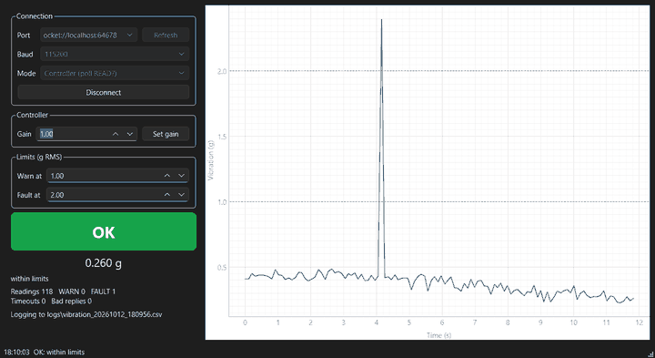
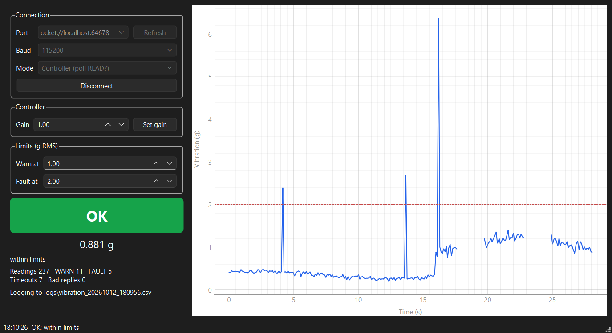

# Vibration Monitor

A Python desktop app (PySide6 / Qt) that talks to a vibration controller over a
serial port, plots live readings, flags out-of-range values and lost
connections, and logs everything to CSV. A bundled simulator stands in for the
controller, so the whole thing can be developed and tested without hardware.
The same app also reads the raw accelerometer stream from the
STM32 sensor node over UART.



## Features

- **Serial link** over pySerial. Works with real COM ports, virtual port pairs (com0com, socat) and the simulator over TCP (`socket://localhost:7000`), all through the same code path (`serial_for_url`).
- **Two modes**
  - *Controller*: polls `READ?` every 100 ms and `STATUS?` every 10th poll, sends `SET GAIN`.
  - *Sensor node*: reads `timestamp,ax,ay,az` lines at 200 Hz and reports the RMS of the dynamic acceleration over a 200-sample window (gravity removed).
- **Status indicator**: OK, WARN or FAULT based on adjustable limits. FAULT is also raised after 3 missed replies in a row, when the controller reports a fault, or when the port drops. A controller fault is latched: it stays FAULT until `STATUS?` answers `OK` again, even while readings are in range.
- **Incomplete lines**: a line cut off by the read timeout (no `
`) counts as a missed reply, never as a reading, so `VAL 0.4` from a half-received `VAL 0.41` is not used.
- **Live plot** of the last 60 s with the warn and fault limits drawn in. Missed replies show as gaps.
- **CSV log** of every reading, status change and event (connect, gain change, timeout, bad reply), flushed on every row.
- **Responsive UI**: all blocking serial I/O runs on a `QThread`, and results come back to the GUI thread through Qt signals.



## Architecture

```
vibmon/
  parser.py        raw line -> Ok / Ack / Value / Gain / Fault / DeviceError / Sample
                   raises ParseError on garbage and ReplyTimeout on empty reads
  serial_link.py   pySerial wrapper: open/close, query(), set_gain(), read_sample()
  monitor.py       OK / WARN / FAULT rules (thresholds, missed reply counter)
  stream.py        rolling RMS for the sensor node stream
  datalog.py       CSV logger
  acquisition.py   QThread that owns the port and emits signals
  app.py           PySide6 window
  simulator.py     controller + sensor node simulator with fault injection
```

The serial, parsing and GUI layers are kept apart. The parser and monitor have
no Qt or pySerial imports, so they're tested as plain functions.

## Protocol

ASCII lines terminated with `\n`.

| Host sends | Controller replies | Notes |
|---|---|---|
| `STATUS?` | `OK` or `FAULT <code>` | |
| `READ?` | `VAL <float>` | vibration in g RMS |
| `SET GAIN <float>` | `ACK` or `ERR OUT_OF_RANGE` / `ERR BAD_ARGUMENT` | gain range 0.1 to 10 |
| `GAIN?` | `GAIN <float>` | |
| anything else | `ERR UNKNOWN_COMMAND` | |

Sensor node stream (no command needed): `<timestamp_ms>,<ax>,<ay>,<az>` in g.

## Install

```bash
python -m venv .venv
source .venv/bin/activate          # Windows: .venv\Scripts\activate
pip install -e ".[dev]"
```

## Run

Start the simulator in one terminal:

```bash
vibmon-sim --tcp 7000                    # controller, with random spikes and silences
vibmon-sim --tcp 7000 --no-faults        # clean signal
vibmon-sim --tcp 7001 --stream --rate 200   # imitate the sensor node
```

Start the app in another terminal and connect to `socket://localhost:7000`:

```bash
vibmon
```

Logs are written to `logs/vibration_<date>_<time>.csv`.

### With a virtual serial port pair

- **Windows**: install [com0com](https://com0com.sourceforge.net/) and create a pair (for example `COM10` and `COM11`). Then run `vibmon-sim --port COM11` and connect the app to `COM10`.
- **Linux / macOS**: run `socat -d -d pty,raw,echo=0 pty,raw,echo=0`, which prints two device paths. Run the simulator on one and connect the app to the other.

### With the sensor node

Plug in the STM32 Nucleo board, choose its COM port, set the baud rate to
115200, choose **Sensor node (stream)** mode and connect.

## Tests

```bash
pytest -v                       # set QT_QPA_PLATFORM=offscreen on a headless machine
```

83 tests:

| File | What it covers |
|---|---|
| `test_parser.py` | every valid reply, garbage lines, non-ASCII bytes, NaN/inf, timeouts, sample lines |
| `test_monitor.py` | threshold bands and boundaries, transitions only, missed-reply counter, device faults and the fault latch |
| `test_serial_link.py` | command round trips against a fake serial object, rejected commands, timeouts, write failures, stale-input flushing, lines cut off by the timeout |
| `test_simulator.py` | protocol, gain scaling, spike and silence injection, end to end over TCP through pySerial |
| `test_stream_and_log.py` | RMS window maths, dropped samples, CSV format and appending |
| `test_app.py` | the real window driven with pytest-qt against the simulator: live plot, gain change, spike FAULT, silence FAULT, latched controller FAULT, stream mode, bad port |

## Demo capture

`python tools/capture_demo.py` runs the app against a seeded simulator for 30 s
and regenerates `docs/screenshot.png` and `docs/demo.gif`. The recorded run
logged 238 readings, 7 timeouts from 2 injected silences, and FAULTs from 3
injected spikes. It also raises the gain to 2.8 partway through to show the
WARN band.
